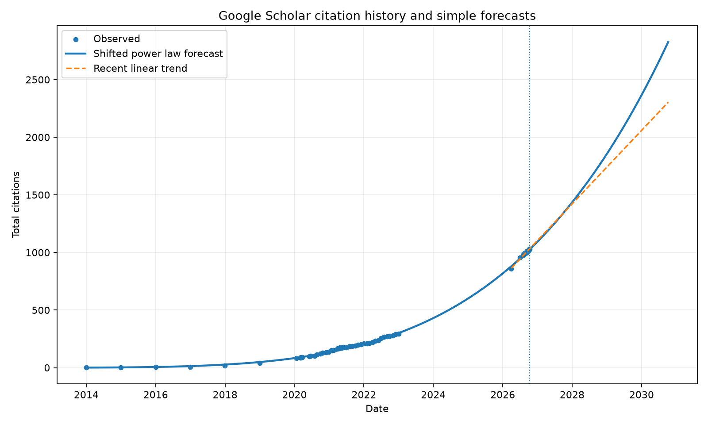

# Citation forecast

Latest observation: **1,036 citations** on 2026-10-16.

## Model comparison

| Model | Training RMSE | Backtest RMSE | 2026 | 2027 | 2028 | 2029 | 2030 |
|---|---:|---:|---:|---:|---:|---:|---:|
| Linear | 144.4 | 605.2 | 716 | 800 | 885 | 969 | 1053 |
| Quadratic | 27.8 | 286.1 | 1040 | 1270 | 1524 | 1799 | 2097 |
| Exponential | 312.4 | 2916.3 | 2332 | 3904 | 6543 | 10951 | 18330 |
| Shifted power law | 9.2 | 11.7 | 1092 | 1434 | 1855 | 2365 | 2978 |

**Recommended simple extrapolation: Shifted power law.** It had the lowest RMSE when models were fit only through 2023-01-01 and then asked to predict the later 2026 observations.

As a short-term sanity check, a straight line fitted only to observations from April 2026 onward gives year-end forecasts of **2026: 1104**, **2027: 1423**, **2028: 1744**, **2029: 2064**, **2030: 2383**.

## Milestones under the recommended model

| Milestone | Approximate crossing |
|---|---|
| 1,100 | 2027-01-10 |
| 1,200 | 2027-05-04 |
| 1,500 | 2028-03-03 |
| 2,000 | 2029-04-22 |
| 2,500 | 2030-03-28 |
| 3,000 | 2031-01-13 |

## Interpretation

- The trajectory is clearly accelerating, but a literal exponential fit extrapolates far too aggressively and performs poorly in the pre-2023 backtest.
- The shifted power law captures accelerating but sub-exponential growth and currently provides the best simple long-horizon backtest among the tested forms.
- Forecast uncertainty here is dominated by model structure, publication timing, field-specific citation dynamics, and Google Scholar indexing changes. Treat the numbers as scenario estimates rather than confidence-calibrated predictions.
- The fitting series uses at most one observation per calendar month so the new three-times-per-week tracker does not overwhelm the sparse historical record.

